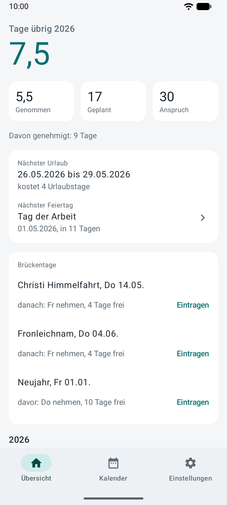
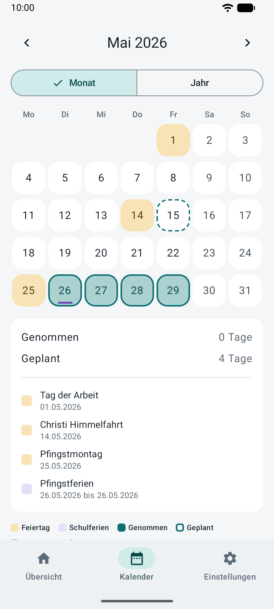
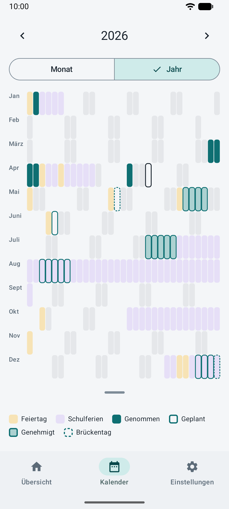
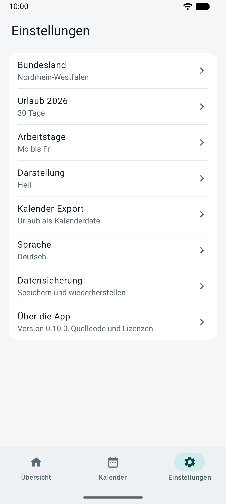

# Urlaubsplaner

[English version below](#english)

Eine Android-App, die dir zuerst zeigt, was du über dein Urlaubsjahr wissen willst: wie viele
Urlaubstage noch übrig sind, wann dein nächster Urlaub ist und wann der nächste Feiertag kommt.
Alles andere ist einen Fingertipp entfernt. Für Deutschland, mit den Feiertagen und Schulferien
aller 16 Bundesländer. Deine Daten bleiben auf deinem Telefon.

<p>
  
  
  
  
</p>

## Was die App kann

- **Feiertage und Schulferien** für dein Bundesland. Die Feiertage werden nach den Regeln des
  Landes berechnet, die Schulferien stehen in einer Datei, die in der App steckt und jedes Jahr
  erneuert wird (aktuell 2026 bis 2029). Die App braucht dafür kein Internet.
- **Urlaubskonto:** Jahresanspruch, Resturlaub aus dem Vorjahr mit einem Datum, an dem er
  verfällt, genommene und geplante Tage, auch halbe Tage. Du wählst deine Arbeitstage, und
  Heiligabend und Silvester zählen so, wie du es willst.
- **Tage eintragen:** einzelne Tage oder einen ganzen Zeitraum im Monatskalender markieren. Die
  Jahresansicht zeigt Feiertage, Schulferien und deinen Urlaub auf einen Blick. Auf Wunsch
  kennzeichnest du, welche geplanten Tage dein Arbeitgeber schon genehmigt hat, und du kannst die
  Urlaubstage eines ganzen Jahres auf einmal löschen.
- **Brückentage:** Die App schlägt vor, an welchen Tagen sich ein Urlaubstag besonders lohnt.
- **Nächster Feiertag:** Ein Tipp in der Übersicht öffnet den Kalender und zeigt den Tag.
- **Kalender-Export (ICS)** für jede Kalender-App.
- **Zwei Widgets** für den Startbildschirm: nächster Urlaub und verbleibende Tage.
- **Sicherung:** Du speicherst eine Sicherungsdatei, wohin du willst, und stellst sie später
  wieder her, zum Beispiel auf einem neuen Telefon.
- Deutsch und Englisch, hell, dunkel und reines Schwarz, wahlweise mit den Farben deines
  Hintergrundbilds.

## Installieren

Die App braucht Android 11 oder neuer.

- **GitHub:** Die neueste Version steht als signierte APK unter
  [Releases](https://github.com/Remph/urlaubsplaner/releases). Vor dem Installieren kannst du den
  SHA-256-Fingerabdruck des Signaturschlüssels mit
  [docs/release.md](docs/release.md) vergleichen.
- **F-Droid:** geplant, die App ist dort noch nicht zu finden.

Die Versionen von GitHub und F-Droid sind mit verschiedenen Schlüsseln signiert und können sich
nicht gegenseitig aktualisieren. Wer von einer zur anderen wechselt, sichert vorher seine Daten
(Einstellungen > Datensicherung), deinstalliert die App und stellt die Sicherung danach wieder her.

## Datenschutz

Die App hat keine Internetberechtigung, kein Konto, keine Werbung und keine Auswertung. Alles
liegt lokal auf dem Telefon. Die Sicherungsdatei und der Kalender-Export gehen nur dorthin, wohin du
sie selbst speicherst oder schickst.

## Daten und Lizenzen

- Der Quelltext steht unter der **GPL-3.0**, siehe [LICENSE](LICENSE).
- Die **Feiertage** berechnet die App selbst, nach den Gesetzen der Länder.
- Die **Schulferien** stammen von der [OpenHolidays API](https://www.openholidaysapi.org) und
  stehen unter der Open Database License (ODbL). Sie liegen mit ihrem eigenen Lizenztext in
  [data/school-holidays/](data/school-holidays/), Hintergründe in
  [docs/data-sources.md](docs/data-sources.md). Bitte prüfe wichtige Termine bei deinem
  Kultusministerium, die App ist keine amtliche Quelle.

## Selbst bauen

Du brauchst JDK 17 oder neuer und das Android SDK (Plattform 37); der Gradle-Wrapper liegt im Repo.

```
./gradlew lint test assembleDebug spotlessCheck   # Prüfungen und Debug-APK
./gradlew -PcoreOnly :core:test                   # nur die Regeln, ohne Android SDK
```

Das Debug-APK liegt dann in `app/build/outputs/apk/debug/`. Eine Anleitung für Windows mit Android
Studio, Telefon und Emulator: [docs/dev-setup.md](docs/dev-setup.md). Aufbau des Projekts und
Pläne: [docs/plan.md](docs/plan.md), Release-Schritte: [docs/release.md](docs/release.md).

## Fehler und Wünsche

Bitte als [Issue auf GitHub](https://github.com/Remph/urlaubsplaner/issues). Urlaubsplaner ist ein
privates Projekt ohne Gewinnabsicht und hat keine Kontakt-E-Mail.

---

## English

Urlaubsplaner is an Android app that shows you first what you want to know about your vacation
year: how many vacation days are left, when your next vacation is, and when the next public
holiday comes. Everything else is one tap away. It is made for Germany, with the public holidays
and school holidays of all 16 federal states, and the app itself is in German and English. Your
data stays on your phone. (The screenshots above are the German version.)

### Features

- **Public holidays and school holidays** for your state. Public holidays are calculated by the
  state's rules; school holidays come from a data file inside the app that is renewed every year
  (currently 2026 to 2029). No internet needed.
- **Vacation balance:** yearly entitlement, days carried over with an expiry date, days taken and
  planned, half days. You choose your working days and how Christmas Eve and New Year's Eve count.
- **Marking days:** single days or a whole range in the month calendar; the year view shows
  holidays, school holidays and your vacation at a glance. Optionally mark which planned days
  your employer has granted, and clear all vacation days of a year at once.
- **Bridge days:** suggestions for where one day off gets you the most days free.
- **Next holiday:** a tap on the overview opens the calendar and shows the day.
- **Calendar export (ICS)** for any calendar app, **two home screen widgets**, and **backup files**
  you save wherever you like.
- Light, dark and pure black themes, optionally with your wallpaper's colours.

### Install

Android 11 or newer. Download the signed APK from
[Releases](https://github.com/Remph/urlaubsplaner/releases) and, if you like, compare the signing
key's SHA-256 fingerprint with [docs/release.md](docs/release.md). F-Droid is planned, not there yet.
The GitHub and F-Droid builds are signed with different keys and cannot update each other: to
switch, back up in Settings > Backup, uninstall, install the other one and restore.

### Privacy

No internet permission, no account, no ads, no tracking. Everything is stored on the phone.
Backups and calendar exports go only where you save or send them yourself.

### Data and licences

The source code is **GPL-3.0** ([LICENSE](LICENSE)). Public holidays are calculated by the app.
School holidays are from the [OpenHolidays API](https://www.openholidaysapi.org) under the Open
Database License (ODbL); the file and its licence text are in
[data/school-holidays/](data/school-holidays/), see also [docs/data-sources.md](docs/data-sources.md).
Please check important dates with your state's ministry of education; the app is not an official
source.

### Build

JDK 17 or newer and the Android SDK (platform 37); the Gradle wrapper is in the repo.

```
./gradlew lint test assembleDebug spotlessCheck   # checks and the debug APK
./gradlew -PcoreOnly :core:test                   # only the rules module, no Android SDK
```

Setting up a Windows PC with Android Studio, a phone and emulators:
[docs/dev-setup.md](docs/dev-setup.md). Project plan: [docs/plan.md](docs/plan.md), releasing:
[docs/release.md](docs/release.md).

### Bugs and wishes

Please open a [GitHub issue](https://github.com/Remph/urlaubsplaner/issues). This is a private,
non-profit project without a contact e-mail.
